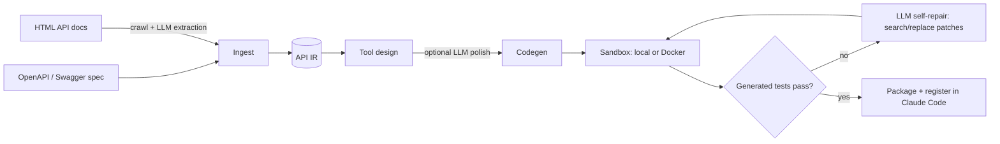

# web-shooter 🕸️

[](https://github.com/ggbifulco/web-shooter/actions/workflows/ci.yml)
[](LICENSE)
[](pyproject.toml)

**Point it at any API docs or OpenAPI spec and get a tested, working MCP server.**

web-shooter reads an API description, decides which endpoints make good tools, generates a
standalone [MCP](https://modelcontextprotocol.io) server, tests every tool in a sandbox, asks an
LLM to repair whatever fails, and registers the result in Claude Code.


## Why

Every assistant can call an API through MCP, but most APIs don't ship an MCP server. Writing one
by hand means mapping endpoints to tools, handling auth, pagination and errors, and then hoping
it works. web-shooter does that in seconds and **proves** it works with generated tests, instead
of handing you code that merely compiles.

## Quick start

```bash
# with uv (recommended)
uvx --from git+https://github.com/ggbifulco/web-shooter web-shooter shoot \
    https://petstore3.swagger.io/api/v3/openapi.json --install-claude project

# or install it
pip install git+https://github.com/ggbifulco/web-shooter
web-shooter shoot ./openapi.yaml --dry-run      # see the planned tools
web-shooter shoot ./openapi.yaml                # generate + test -> out/<name>-mcp
web-shooter test out/<name>-mcp --live          # re-run tests against the real API
```

Specs (OpenAPI 3.x, Swagger 2.0; JSON or YAML; file or URL) need no API key.
HTML documentation pages are read with Claude and need `ANTHROPIC_API_KEY`
(see [.env.example](.env.example)).

### As a Claude Code plugin

```
/plugin install web-shooter --marketplace ggbifulco/web-shooter
/web-shooter https://petstore3.swagger.io/api/v3/openapi.json
```

The plugin adds a `/web-shooter` command and a skill that tells Claude when to use it. After the
tests pass, the generated server is registered in the project's `.mcp.json`.

## How it works



| Stage | What happens | Code |
|---|---|---|
| Ingest | OpenAPI/Swagger parsed with `$ref` resolution (cycles cut), Swagger 2 converted; HTML docs crawled (same section, depth-limited), cleaned to markdown, split per endpoint, extracted by Claude with structured outputs. Every extracted endpoint keeps its source URL and a verbatim excerpt; a grounding check lowers confidence when the excerpt or path isn't really in the page. | [`ingest/`](src/web_shooter/ingest) |
| IR | One normalized model (`APISpec`, `Endpoint`, `Parameter`, `AuthScheme`…) that every later stage consumes. | [`ir.py`](src/web_shooter/ir.py) |
| Tool design | Stable snake_case names, descriptions with the HTTP signature, JSON input schemas (flat body fields or a wrapped `body`), `all_pages` for page/offset pagination, DELETE skipped unless `--include-destructive`, optional CRUD consolidation into one tool with an `action` enum. | [`tools.py`](src/web_shooter/tools.py) |
| Codegen | A standalone package: `pyproject.toml`, `Dockerfile`, README, `tools.json` and a small runtime on the official MCP SDK (auth via env vars, retries on 429/5xx, host allowlist, mock mode). | [`codegen/`](src/web_shooter/codegen) |
| Sandbox | `local` subprocess, or `docker` with `--network none` (mock), `--read-only`, memory/CPU/pids limits, all capabilities dropped. | [`sandbox.py`](src/web_shooter/sandbox.py) |
| Tests | Per tool: a valid call (response validated against the declared schema), a call missing a required argument and one with a wrong type (both must be rejected). Mock mode needs no key; `--live` hits the real API and marks 4xx answers to made-up inputs as *inconclusive*, not passed. | [`testing.py`](src/web_shooter/testing.py) |
| Self-repair | Failures (arguments, error, response) plus `tools.json` and the runtime go to Claude, which answers with search/replace edits. Bounded iterations, every edit validated, each round logged to `repair_log.json`. | [`repair.py`](src/web_shooter/repair.py) |

## Benchmark

`uv run python benchmarks/run.py` runs the whole pipeline on 20 public APIs
([list](benchmarks/apis.yaml)): 16 specs, 4 docs-only sites. Mock-mode tests, local sandbox, no LLM
key in this run.

<!-- benchmark:start -->
| API | Input | Endpoints | Tools | Tests passed | Repair iters | LLM cost | Time | Status |
|---|---|---:|---:|---:|---:|---:|---:|---|
| Swagger Petstore v3 | spec | 19 | 16 | 38/38 | 0 | $0.00 | 2.5s | ok |
| Swagger Petstore v2 | spec | 20 | 16 | 39/39 | 0 | $0.00 | 2.2s | ok |
| xkcd | spec | 2 | 2 | 4/4 | 0 | $0.00 | 1.7s | ok |
| APIs.guru | spec | 7 | 7 | 15/15 | 0 | $0.00 | 1.8s | ok |
| NYT Top Stories | spec | 1 | 1 | 3/3 | 0 | $0.00 | 1.9s | ok |
| Spotify | spec | 88 | 80 | 214/214 | 0 | $0.00 | 4.2s | ok |
| NASA APOD | spec | 1 | 1 | 2/2 | 0 | $0.00 | 1.8s | ok |
| httpbin | spec | 73 | 67 | 138/138 | 0 | $0.00 | 2.4s | ok |
| Listen Notes | spec | 23 | 22 | 64/66 | 0 | $0.00 | 2.7s | failing |
| Wikimedia | spec | 35 | 35 | 101/101 | 0 | $0.00 | 2.4s | ok |
| Giphy | spec | 10 | 10 | 25/25 | 0 | $0.00 | 2.1s | ok |
| ExchangeRate-API | spec | 1 | 1 | 3/3 | 0 | $0.00 | 1.7s | ok |
| Lyft | spec | 16 | 16 | 43/46 | 0 | $0.00 | 2.0s | failing |
| CircleCI | spec | 22 | 19 | 50/50 | 0 | $0.00 | 2.0s | ok |
| UK Vehicle Enquiry | spec | 1 | 1 | 3/3 | 0 | $0.00 | 1.7s | ok |
| Gitea | spec | 325 | 267 | 747/747 | 0 | $0.00 | 11.0s | ok |
| JSONPlaceholder | docs | - | - | - | - | - | - | needs LLM key  |
| Dog CEO | docs | - | - | - | - | - | - | needs LLM key  |
| Random User | docs | - | - | - | - | - | - | needs LLM key  |
| Chuck Norris | docs | - | - | - | - | - | - | needs LLM key  |

**14/16 APIs fully green, 1489/1494 generated tests passing** (4 not run).
<!-- benchmark:end -->

Notes, so the numbers are read correctly:

- The 5 remaining failures come from the specs themselves: Lyft declares `ride_profile` as both
  `type: object` and a string enum, and two Listen Notes responses use `oneOf` options that any
  object matches, so no response can satisfy them. web-shooter reports this instead of hiding it.
- Mock mode checks that every tool accepts valid input, rejects invalid input and that its
  request is built correctly; it does not prove the real API behaves as documented. Use `--live`
  with credentials for that.
- Docs-only rows need `ANTHROPIC_API_KEY`; repair iterations and LLM cost are 0 here because all
  spec-based servers passed without repair.
- Running the benchmark found and fixed four real bugs in the mock-data generator and the
  Swagger converter (see the git history).

## Development

```bash
uv sync
uv run pytest            # 77 tests; Docker tests run when a daemon is available
uv run ruff check . && uv run ruff format --check . && uv run mypy
```

The suite includes a fake Petstore HTTP server, so live-mode tests (real HTTP, auth, pagination
across pages, 404 handling) run offline. LLM steps are tested with a scripted LLM.

## Roadmap

Tracked on the [project board](https://github.com/users/ggbifulco/projects/5). Ideas next:
OAuth2 flows, streamable HTTP transport for generated servers, an egress proxy for a real
network allowlist in live Docker runs, and an LLM-backed benchmark run on the docs-only APIs.

## License

MIT
